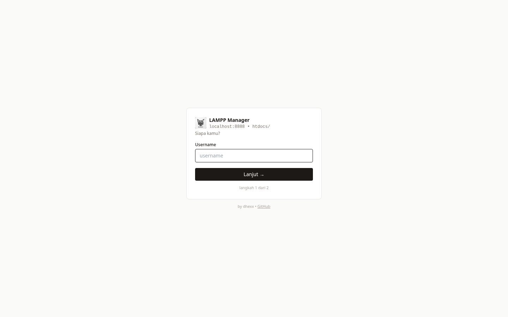
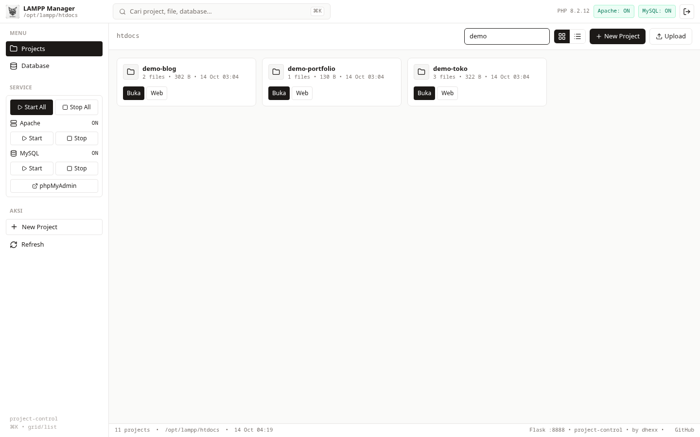
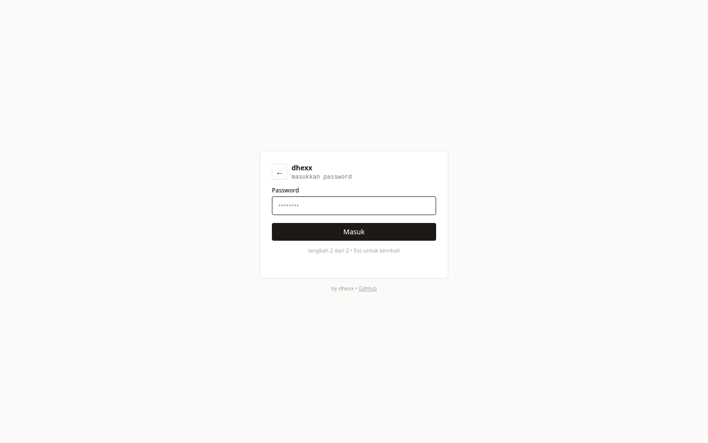

# LAMPP Manager

Local web manager for XAMPP/LAMPP on Linux — project library, file CRUD + upload, MySQL overview, Apache/MySQL start-stop, one-key editor & browser launch.

Built with Flask. Stays running even when Apache is down, so you can always start your stack back up.

## Screenshots

| Login (step 1 → 2) | Dashboard |
|---|---|
|  |  |
|  | Project library with service status, start/stop controls, and database tab. |

## Features

- **Project library** — grid/list view of `htdocs` with search (`Ctrl/⌘ + K`), file counts, sizes, and modification dates
- **Project CRUD** — create (PHP/HTML/blank templates), rename, duplicate, delete with protection for system folders
- **File browser** — navigate any project, create files/folders, rename, delete, download, drag-and-drop upload (extension allowlist, 20 MB limit)
- **Service control** — start/stop Apache & MySQL from the dashboard (via a tightly-scoped sudoers rule)
- **Reliable status detection** — cross-checks `ctlscript.sh`, process table, ports, and live connections, so indicators stay accurate even when services run as root
- **Database tab** — list databases with table counts, create/drop, import `.sql`, one-click jump to phpMyAdmin
- **Editor shortcuts** — open any project in Antigravity or Sublime Text with one click (native app icons)
- **Simple auth** — single local user, scrypt-hashed password, session cookies
- **`project-control` CLI** — open the dashboard, edit projects, check status, tail logs from the terminal
- **Autostart** — `systemd --user` service, Wayland/X11 aware
- **Log viewer** — Apache `error_log` (+ MySQL `.err` with one extra sudoers line), auto-refresh, download
- **Content search** — grep across all projects integrated into `⌘K`, with file:line hits
- **One-click backup** — zip project + `mysqldump` database to `~/Backups/lampp-manager/`, download/delete from dashboard
- **Pin + bulk actions** — pin frequent projects to top, multi-select delete/duplicate/backup
- **Self update** — `git pull` from the dashboard with scheduled service restart
- **Dark mode** — toggle with `localStorage` persistence, follows system by default

## Quick start

```bash
# 1. Clone & set up
git clone https://github.com/dhamm-dev/lampp-manager-by-dhexx.git ~/Projects/lampp-manager
cd ~/Projects/lampp-manager
python3 -m venv .venv && .venv/bin/pip install -r requirements.txt
cp .env.example .env   # then fill in ADMIN_USER, ADMIN_PASS_HASH, SECRET_KEY

# 2. Enable start/stop without a password prompt (one time)
sudo cp sudoers-lampp-manager /etc/sudoers.d/lampp-manager
sudo chmod 440 /etc/sudoers.d/lampp-manager
sudo visudo -c

# 3. Install CLI shortcut + autostart
cp project-control ~/.local/bin/project-control   # if not already there
chmod +x ~/.local/bin/project-control
systemctl --user daemon-reload
systemctl --user enable --now lampp-manager

# 4. Open it
project-control
# → http://localhost:8888
```

Generate credentials:

```bash
# password hash
.venv/bin/python -c "from werkzeug.security import generate_password_hash; print(generate_password_hash('your-password'))"
# secret key
python3 -c "import secrets; print(secrets.token_hex(32))"
```

## Usage

| Action | How |
|---|---|
| Open dashboard | `project-control` (auto-starts the service) |
| Open project in editor | Click the Antigravity / Sublime icon, or `project-control edit (folder)` (`--subl` for Sublime) |
| Open project in browser | Click `Web` → `http://localhost/(folder)` |
| Manage files | Click a project card to browse, create, upload, download |
| Manage databases | `Database` tab → create/drop/import, or jump to phpMyAdmin |
| Service status | `project-control status` |
| Logs | `project-control logs` |

## Configuration (`.env`)

| Key | Description | Default |
|---|---|---|
| `ADMIN_USER` | Dashboard username | `admin` |
| `ADMIN_PASS_HASH` | scrypt/bcrypt hash of the password | — (required) |
| `SECRET_KEY` | Flask session secret (32-byte hex) | — (required) |
| `PORT` | Port the dashboard listens on | `8888` |

> Never commit `.env`. Only `.env.example` is tracked.

## How it works

```
Browser → http://localhost:8888 (Flask, user service, always on)
  ├─ http://localhost/(project)  (Apache, port 80)
  ├─ start/stop ──→ sudo /opt/lampp/ctlscript.sh  (NOPASSWD, this script only)
  ├─ file ops ──→ /opt/lampp/htdocs  (jailed with realpath + prefix checks)
  ├─ db info ──→ /opt/lampp/bin/mysql -u root
  └─ open in editor ──→ /usr/bin/antigravity-ide | /usr/bin/subl
```

**Why not inside `htdocs`?** A manager living in `htdocs/` dies together with Apache — exactly when you need the Start button most. Running as a separate service keeps the dashboard reachable at all times.

**Why status doesn't trust `ctlscript.sh` alone?** Its check (`kill -0 <pid>`) fails for root-owned processes when queried as a normal user, and the MySQL pidfile isn't readable either — so it reports "not running" while services are up. The backend additionally checks the process table, ports 80/3306, and a live MySQL connection.

## Security notes

- Designed for **local use only** — it binds to `127.0.0.1`, but do not expose port 8888 to a network.
- The sudoers rule allows **only** `/opt/lampp/ctlscript.sh *` — no blanket sudo.
- Uploads are restricted by extension allowlist and size; all paths are jailed to `htdocs`.
- `rm` is intentionally unavailable anywhere; deletion goes through explicit confirm flows.

## Project structure

```
lampp-manager/
├── app.py                    # Flask backend (auth, projects, files, db, services)
├── templates/                # login.html, index.html (Tailwind + Lucide, no build step)
├── static/icons/             # editor icons, logo, favicon
├── docs/                     # screenshots for README
├── project-control           # CLI shortcut (source; installed to ~/.local/bin/)
├── lampp-manager.service     # systemd --user unit (source; installed to ~/.config/systemd/user/)
├── sudoers-lampp-manager     # scoped NOPASSWD rule (source; installed to /etc/sudoers.d/)
├── lampp-autostart.service   # optional: start Apache+MySQL at boot (system unit, needs root)
├── requirements.txt
├── .env.example
└── README.md
```

## Troubleshooting

| Symptom | Fix |
|---|---|
| Start/Stop returns `sudo: a password is required` | Install the sudoers file (step 2) and restart the service |
| Status shows OFF while services run | Fixed in current version (multi-source detection); `project-control restart` and refresh |
| Dashboard unreachable | `systemctl --user status lampp-manager`, then `project-control logs` |
| Login fails after `.env` edit | `systemctl --user restart lampp-manager` (env loads at startup) |

## Roadmap

- Web terminal drawer (scoped command runner: `ls`, `php`, `mysql -e`, …)
- Table-level database browser (currently delegated to phpMyAdmin)

## LAMPP autostart at boot (optional)

```bash
sudo cp ~/Projects/lampp-manager/lampp-autostart.service /etc/systemd/system/lampp-autostart.service
sudo systemctl daemon-reload
sudo systemctl enable --now lampp-autostart
systemctl is-enabled lampp-autostart   # harus: enabled
```

## License

MIT — do what you want, no warranty.
